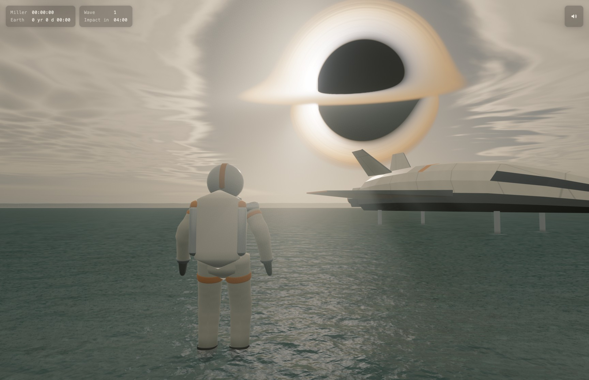
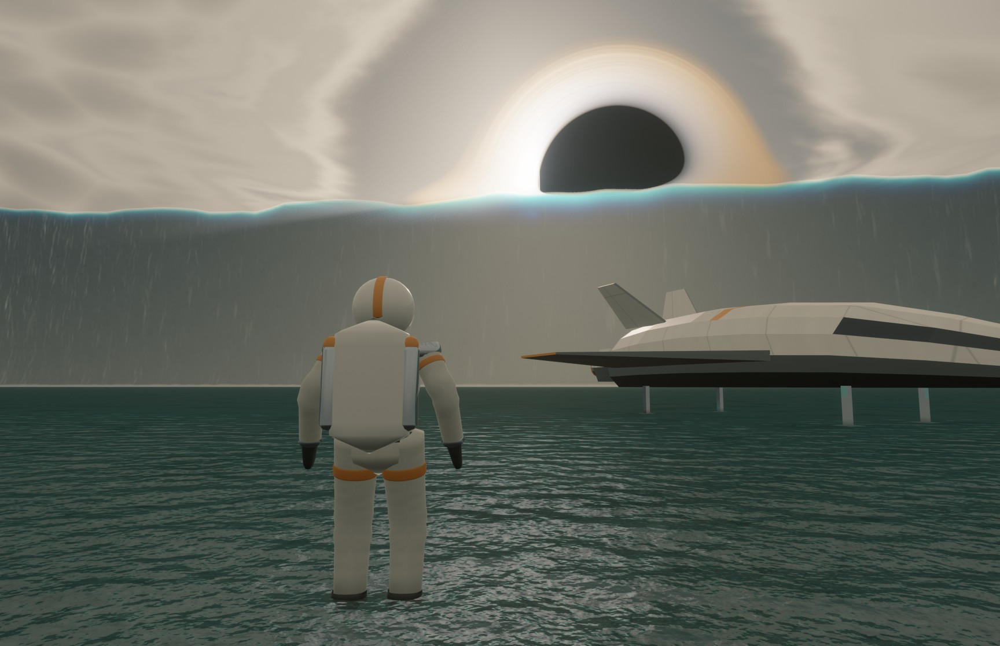
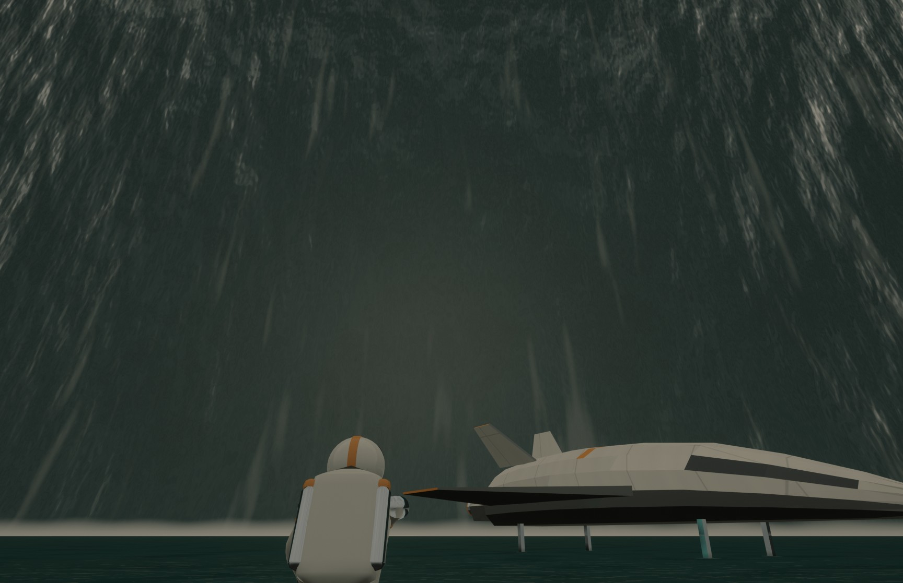
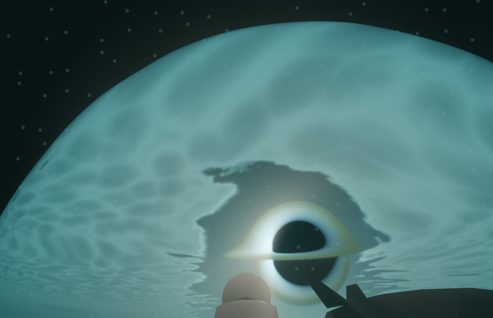

# Miller's Planet

A walkable, real-time recreation of the water planet from *Interstellar*, running in the browser on WebGPU. You wade as an astronaut through ankle-deep water that runs to the horizon, under a hazy overcast sky, with the black hole Gargantua hanging huge above the sea and a landed ship nearby. Every five minutes a wave more than a kilometre tall rolls in from Gargantua's direction, its thin crest glowing turquoise with the light behind it. You brace, it passes over, you spend a few seconds under water looking up through Snell's window, the water drains, and the walk goes on. Two clocks in the corner show time on the planet and on Earth, where it runs 61,362 times faster. It is built with [Babylon.js](https://www.babylonjs.com/) 9.18 and hand-written WGSL shaders, and everything you see and hear is generated in code: there are no texture, model, animation or sound files.

**Built on the work of Noniv (Maksymilian Dendura):** the character, sea, sky and post-processing techniques come from his [snowflow_demo](https://github.com/Noniv/snowflow_demo) and [web-ocean](https://github.com/Noniv/web-ocean) (both MIT). See [Credits](#credits).









## Run it

You need a desktop browser with WebGPU: a recent Chrome or Edge. Without WebGPU the page shows one line saying so. It was developed and measured in Chrome 155 on macOS; other browsers and systems have not been tested.

```bash
npm install
npm run dev
```

For the production build, `npm run build` writes a static site to `dist/`: an `index.html`, a main script with four small chunks, and two licence files, 317.8 kB in total with brotli (402.0 kB gzip). Serve that folder with any static web server, for example `npm run preview`. Opening `dist/index.html` straight from the disk does not work, because Chrome blocks module scripts loaded from `file://`.

The first click on the canvas captures the mouse and starts the sound.

## Controls

| Input | Action |
|---|---|
| Click | Capture the mouse and start the sound |
| Mouse | Orbit the camera: all the way round, and from 30° down to 60° up in the third-person views |
| W A S D or the arrow keys | Wade (about 1.0 m/s) |
| Shift | Wade a little faster (about 1.3 m/s) |
| C | Cycle the three views: third person, closer third person, first person |
| Esc | Release the mouse |

There is no zoom: the mouse wheel and trackpad pinch do nothing, and the three views on C are the only distances. There is no jumping, combat or interaction either. The movement follows *God of War* (2018): the astronaut turns toward where you walk, slows in turns, takes small steps to turn on the spot, and the camera eases back behind you while you walk. From eight seconds before a wave hits until it has drained, the controls are locked and a scripted camera takes over; your own view comes back afterwards.

URL parameters, mainly for testing:

| Parameter | Effect |
|---|---|
| `?scale=0.7` | Pin the internal render scale (normally automatic) |
| `?time=280` | Freeze the clock at a time in seconds (the first wave hits at 300) |
| `?shot=crest-backlit` | Jump to a named camera shot (the list is in `tools/shots.mjs`) |
| `?systems=-wave,-ship` | Switch systems off: `sea`, `wave`, `astronaut`, `ship`, `gargantua`, `atmosphere`, `bloom`, `shafts`, `temporalUpscale`, `jitter` |
| `?hud=0` | Hide the clocks |

The page also exposes `window.millersPlanet` (stats, shots, frame timings, a time skip), which the test tools in `tools/` drive.

## How it works

### Gargantua

The black hole is ray traced with the same physics as my real-time Kerr black hole renderer: light paths are integrated through the Kerr spacetime of a black hole spinning at 0.998 of the maximum, with a Page–Thorne accretion disk and a blackbody colour table. A compute shader traces a 1024 × 800 patch of sky around Gargantua, one sixteenth of the rows per frame, so a fresh image arrives about four times a second and never causes a slow frame; the last two images are cross-faded. The viewer sits 30 gravitational radii out, 6° above the disk plane, and the disk animates at 0.5 M per second. A self-test checks traced rays against a double-precision reference.

### Sky, clouds and light

The sky uses Sébastien Hillaire's atmosphere method, as in web-ocean: compute shaders build a transmittance table (256 × 64), multiple scattering (32 × 32), a sky view (256 × 144) and a 32³ haze volume around the camera. A procedural stratus deck 1.5 km up, baked into a 4096 × 1024 texture, covers the sky in cream overcast and opens into a clearing around Gargantua so the disk shows through. Gargantua's disk is the key light: its colour and brightness are measured from the traced patch, and it lights the scene as an area light, so shadows are soft.

### The shallow sea

The sea is three FFT cascades of 256 × 256 (7.43 m, 1.39 m and 26 cm patches) with a TMA spectrum for 20 cm of water, under the film's 1.3 g (12.75 m/s²), with 5 m/s of wind and waves about 3.5 cm high. The waves move with finite-depth capillary–gravity dispersion, so a test wave of 1.86 m turns at 5.038 rad/s against the 5.041 predicted for that depth (deep water would be 6.57). A clipmap of about 320,000 triangles follows the player. Up close you look through the slightly murky water at a procedural seabed of sand, ripple marks and stones. Further out it turns dark slate, as in the film. Rough water reflects less at grazing angles, because the facets you can see there tilt toward you, so a soft glitter path runs under Gargantua.

### Footsteps and wakes

A 512 × 512 ripple field at 2 cm per texel follows the astronaut. Each heel strike and toe-off stamps it, the shins push a small wake, and the rings spread with a kernel built from the same dispersion as the sea: a ring's peak travels at 0.34 m/s against the 0.324 m/s predicted for its wavelengths.

### The astronaut

The suit is built like the character in snowflow_demo: a skeleton (22 bones here) and a table of rings lofted into a mesh at load time, adapted to a stiff suit with a padded torso, rigid joints, boots and a backpack (6,916 triangles for the body and 768 for the visor). The feet stay planted while they carry weight; measured over a 27-second scripted walk, no point of a sole moves more than about 1 cm while it touches the seabed. The visor is a mirror: it reflects Gargantua, the clouds, the sea and the wave.

### The lander

An original design in the shape language of the film's Ranger: flat faceted plates, a thin wedge with swept wings and twin canted tail fins, an off-white top over a dark belly, no markings. It has five states: intact, beached and dented, broken with a wing torn off, scattered wreckage, and gone. After each wave it turns up 100 to 150 m downstream of where you were hit (about a two-minute walk), more damaged, and it is gone after the fourth wave. The astronaut slides along it instead of walking through it, and the camera moves in so it never passes through the hull.

### The wave

The wave is a scripted shape, not a fluid simulation: a steep two-sided ridge 1.2 km tall and about 1 km wide, with its height and crest line varying along its 60 km length. From the start it waits on the horizon like a hazy mountain range; a minute before impact it starts to move, and twenty seconds out its crest is level with Gargantua. The crest glows because the shader follows the view ray through the thin wedge of water at the top: the light of Gargantua and the sky behind it passes through with water's real absorption (red is lost first) plus forward scattering, so thin parts glow turquoise and the thick face stays dark. As the wall closes in, the light and the sky dim, and the sea, the suit, the visor and the lander all reflect the wall and its crest.

### Under water

For five seconds the camera is under the wave. Looking up, you see the sky through Snell's window: the surface above squeezes the whole sky into a circle within 48.6° of straight up, with exact Fresnel transmission and total internal reflection outside it, and Gargantua wobbles near the window's edge. Light shafts, bubbles and a low-pass muffle on the sound complete it. Then the water drains with streaks of whitewater, the astronaut stands up, and the suit stays wet for a minute and a half.

### Post-processing and resolution

The scene is drawn at a lower internal resolution and brought to full size by temporal upscaling with motion vectors, then bloom, light shafts, a slight depth of field, AgX tone mapping, a gentle colour grade that cools the shadows and leaves the highlights alone (matched to the film), a vignette and film grain, following snowflow_demo. The internal resolution adapts continuously to keep the GPU inside its budget. It steers by GPU time corrected for the GPU's clock speed, because macOS lowers the clock whenever a frame finishes early, which makes raw timings read high.

### Far from the start

Single-precision floats lose detail far from the origin, so once you are 1 km from it, the whole world quietly re-centres on you by a multiple of 1,024 m, a distance that keeps every repeating texture and mesh aligned. A test across that line found no visible change and nothing that jumps.

### Clocks and sound

The clocks show Miller time (hours, minutes, seconds) and Earth time (years, days, hours, minutes) at the film's ratio of 61,362. The sound is generated with Web Audio from noise and simple oscillators: the sea, wading splashes, the rising roar of the wave, the muffle and bubbles under water.

## Physics honesty

| What | Label |
|---|---|
| Light bending around Gargantua (Kerr geodesics), at spin 0.998, checked against double-precision references | Exact |
| Spin 0.998 is below the near-maximum spin the film needs for its time dilation; the renderer's disk model tops out there | Stated |
| The clock ratio of 61,362 (1 hour = 7 years) is the film's figure, applied exactly; it is not derived from the spacetime here (at spin 0.998 no stable orbit slows time by more than about 10.8×) | The film's figure |
| The viewpoint: an observer 30 gravitational radii out, close to a static observer. It is not Miller's real orbit, and no observer moving with the planet is modelled | Artistic |
| Gargantua's distance, its place in the sky, the disk colours and the speed of the disk animation | Artistic |
| Atmosphere scattering (Hillaire) | Physically based; the haze density, cloud deck and darkened shadow are artistic |
| The sea's wave statistics, with finite-depth dispersion at 1.3 g, and its small-scale roughness (the clean-sea value for a 5 m/s wind) | Physically based; wave height and wind are chosen values |
| The far water's darkness: rough water reflects less at grazing angles, because you see facets tilted toward you | Approximation, tuned to the film's stills |
| The water's grey-green murk and the colour grade (cool shadows, untouched highlights) | Artistic, matched to the film |
| Footstep ripples, from the same dispersion | Physically based; their damping and shapes are artistic |
| The seabed (sand, ripple marks, stones) | Artistic |
| Snell's window, Fresnel and water absorption | Real optics; the bright light under a 1.2 km wave is artistic |
| The giant wave: its existence over 20 cm of water, its shape, speed, five-minute spacing and drain | Artistic |
| The crest's turquoise glow | Physically motivated (absorption and forward scattering), but exaggerated |
| Light dimming under the wall, and the soft shadows | Approximations |
| The mirrored visor (the film's visors are clear) and Gargantua seen from the surface (the film never shows it) | Artistic |
| The walk, the ship's damage and its relocation | Artistic |
| The sounds | Artistic |

## Fan art

This is a non-commercial fan tribute to *Interstellar*. It uses no frames, models, sounds or logos from the film. The lander is an original design, and every image, mesh and sound is generated in code.

## Performance

Measured in headless Chrome 155 on a 16-inch MacBook Pro (M3 Pro with an 18-core GPU, macOS 15.7.3) at the panel's full 3456 × 2234, on mains power, from the production build. There were five scripted 30-second flights, each run three times:
- walking, orbiting the camera and switching views, with and without the clocks;
- sweeping over the sea, including an instant flick from the sky down to the water;
- the first wave, from 22 seconds before impact to 8 seconds after, through the brace, the underwater pass and the drain;
- a stress test on a test scene that jumps from looking straight up to looking straight down.

GPU time at full clock speed stayed at most 11.0 ms (p99) and 16.6 ms (maximum), against a 16.7 ms frame. The internal resolution stayed at 100% most of the time and dipped to 50% at worst, right after the instant camera jumps. In 14 of the 15 runs, every frame arrived within 16.8 ms of the one before. The other run had one late frame (33 ms) while looking at the sky, with the GPU nearly idle, just as macOS was lowering the GPU clock. Across all the passes, this kind of single hitch appeared about once in every six to ten runs, always in very light views. I have not found its cause.

Measured without corrections, the GPU time reads higher: 11 to 15 ms (p99), with single frames above 20 ms right after the instant camera jumps. The cause is macOS slowing the GPU clock whenever a frame finishes early. I have not checked a real display or a screen recording.

## Known limitations

- Desktop Chrome and Edge only (WebGPU); no phones, tablets, Safari or Firefox.
- Smoothness was measured in headless Chrome, not on a real display, at 120 Hz, or in a recording.
- About once in every six to ten 30-second runs, one frame arrives late (33 ms) while the view is mostly bright sky, just as macOS lowers the GPU clock. The cause is unknown.
- No splash droplets: water contact shows as wakes, rings and whitewater.
- The sea reflects the sky and the wave, but not the ship or the astronaut, so from far away the lander can look as if it stands on the water.
- Shadows are soft stand-ins cast by simple shapes; nothing shadows itself.
- When a hull or wing of the ship comes between the camera and the astronaut, the camera jumps in to stay clear of it.
- The wave is a shaped effect, not a fluid simulation; its back slope looks smooth and flat as it recedes, and from far away (a minute before impact) it is faint.
- The sea is calmer than the film's: its waves are a few centimetres high, so the broad, sparkling glint field and the chop of the film's water are missing.
- Esc releasing the mouse was not tested automatically (headless Chrome cannot send it).

## Credits

This project stands on the work of **Noniv (Maksymilian Dendura)**, whose two MIT-licensed projects showed how to build this kind of scene in the browser:
- **[snowflow_demo](https://github.com/Noniv/snowflow_demo)**: the Babylon.js, Vite and WGSL setup; the procedural character lofted from a table of rings, with its skeleton and planted-foot walk; the sea's clipmap mesh; and the post chain (temporal upscaling, light shafts and the composite).
- **[web-ocean](https://github.com/Noniv/web-ocean)**: the FFT ocean and its spectrum, Hillaire's atmosphere chain, the cloud deck, the bloom and the procedural noise.

Licence notices:
- snowflow_demo: Copyright (c) 2026 Maksymilian Dendura, MIT License.
- web-ocean: Copyright (c) 2026 Maksymilian Dendura, MIT License.

Every file derived from his code keeps his copyright and MIT licence header, and [LICENSE](LICENSE) carries both notices with the full licence text. The production build ships them as `LICENSE.txt`.

Ready-to-paste credit line for posts:

> Built on Noniv's snowflow_demo and web-ocean (MIT): github.com/Noniv/snowflow_demo · github.com/Noniv/web-ocean

The site also bundles [Babylon.js](https://github.com/BabylonJS/Babylon.js) under the Apache License 2.0; its notice and licence are in [THIRD-PARTY-NOTICES.md](THIRD-PARTY-NOTICES.md) and ship with the build as `THIRD-PARTY-NOTICES.txt`.

## How it was made

I wrote one long build prompt for Claude Code (Claude Opus 5.5). It set the hard requirements: 60 fps at 3456 × 2234 on my M3 Pro, no free zoom, a visor that reflects Gargantua and the wave, a backlit turquoise crest, two clocks and nothing else on screen, under 1.5 MB, and an honest physics section. It listed the references to study: Noniv's two projects, my black hole renderer and its test tools. And it split the build into nine phases, each with a gate that had to pass with evidence before the next one started.

Claude Code built it phase by phase and checked its own work with a headless-Chrome test harness: fixed camera shots it had to look at and critique, GPU timings per pass, paced 30-second flights, real keyboard and mouse tests, and scripted runs such as five waves in a row with the ship's state checked after each. When the 60 fps rule turned out to measure macOS's power management rather than the work, it stopped and asked me how to judge it, and I chose frame gaps plus GPU time at full clock speed.

## Repository layout

| Path | Contents |
|---|---|
| `index.html`, `src/main.js` | Page and entry point |
| `src/core/` | App loop, page API, clock, input, frame pacing, URL parameters |
| `src/gpu/` | GPU timing, dynamic resolution, render targets, shader registry |
| `src/sky/` | Gargantua's ray tracer, atmosphere, clouds and sky dome |
| `src/sea/` | FFT sea, clipmap, seabed and footstep ripples |
| `src/wave/` | The giant wave, its timeline, reflections and the underwater view |
| `src/character/` | The astronaut: skeleton, suit mesh, walk and materials |
| `src/camera/` | Third-person camera and the scripted wave camera |
| `src/ship/` | The lander and its damage states |
| `src/world/` | Simple stand-in shapes for shadows, collision and submerged parts |
| `src/post/` | Temporal upscaling, bloom, light shafts and the final composite |
| `src/hud/`, `src/audio/` | The clocks and the procedural sound |
| `src/debug/` | Named camera shots and engine self-checks |
| `tools/` | Headless-Chrome harness: shots, benchmarks, flights, input tests, wave run, size report |
| `evidence/final/` | The final set of screenshots |
| `LICENSE`, `THIRD-PARTY-NOTICES.md` | This project's and Noniv's MIT notices; Babylon.js's Apache 2.0 notice |
