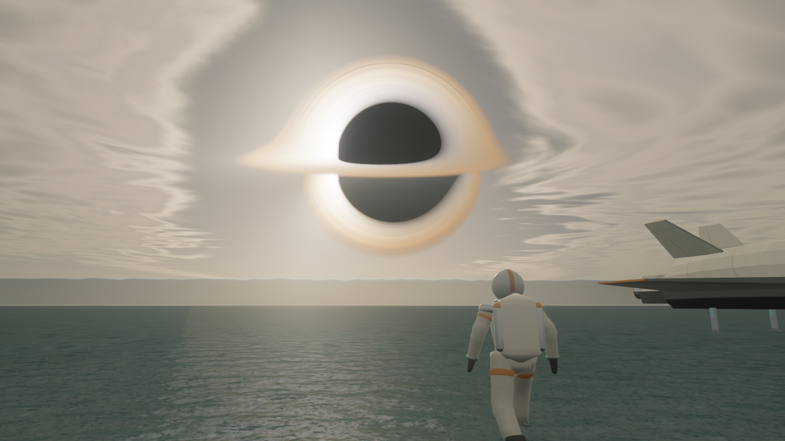
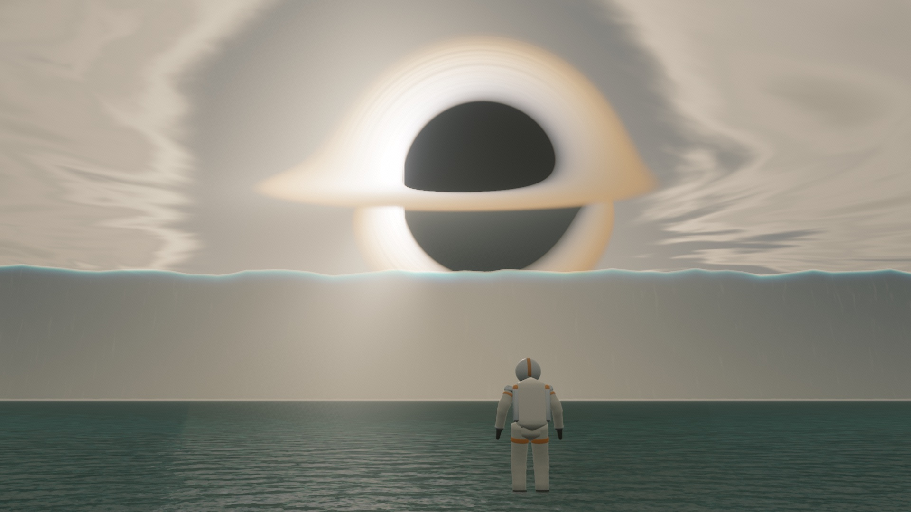
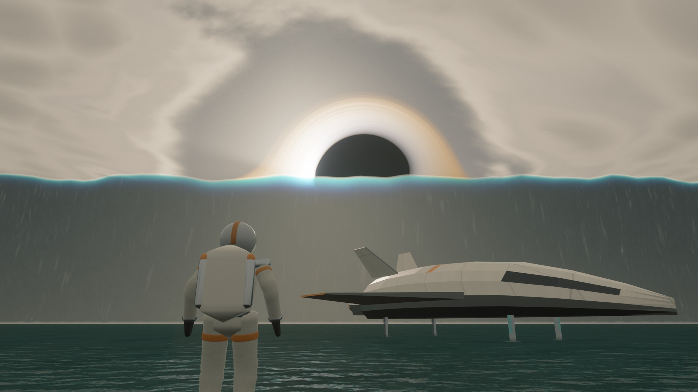
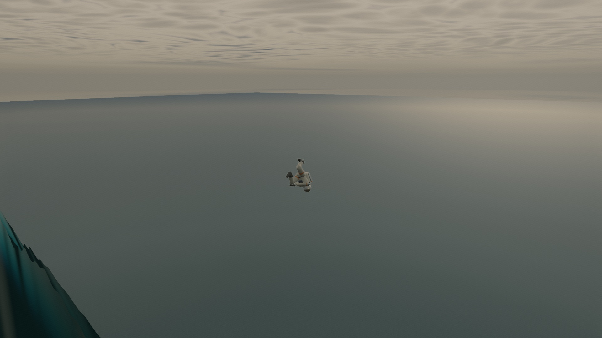
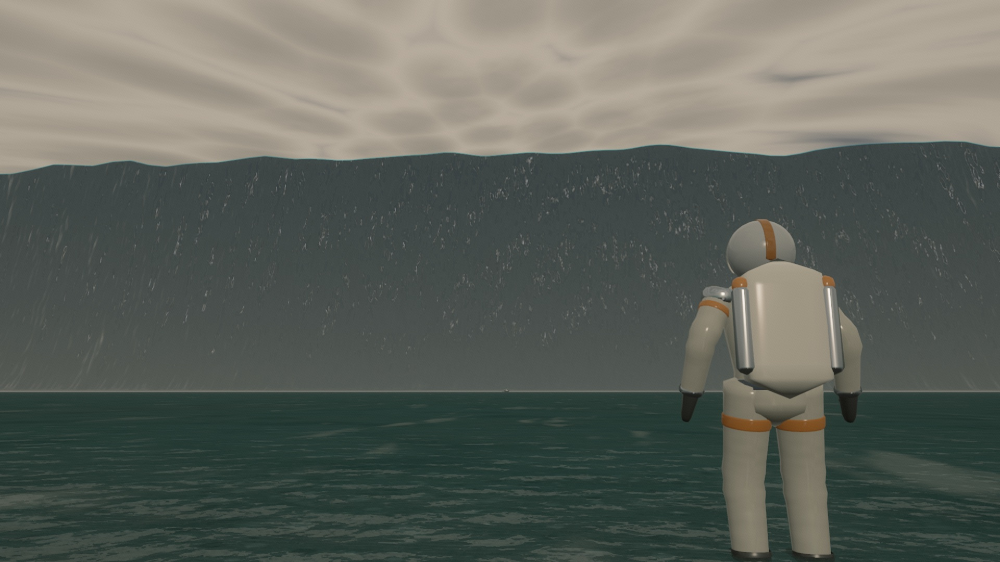

# Miller's Planet

**[▶ Play it in your browser: millers-planet.onrender.com](https://millers-planet.onrender.com)** · [Watch the trailer](media/millers-planet-trailer.mp4)

A walkable, real-time recreation of the water planet from *Interstellar*, running in the browser on WebGPU. You wade through ankle-deep water under a grey overcast, with the black hole Gargantua hanging huge over the sea and a landed ship nearby. Every four minutes a wave 2.4 km tall rolls in, its crest glowing turquoise with Gargantua's light behind it; it sweeps you up its face, throws you over the crest and drops you on the far side, and the walk goes on. Two clocks show time on the planet and on Earth, where it runs 61,362 times faster. Everything you see and hear is generated in code: no texture, model, animation or sound files.

[](https://millers-planet.onrender.com)

| | |
|---|---|
|  |  |
|  |  |

**Built on the work of Noniv (Maksymilian Dendura):** the character, sea, sky and post-processing techniques come from his [snowflow_demo](https://github.com/Noniv/snowflow_demo) and [web-ocean](https://github.com/Noniv/web-ocean) (both MIT). See [Credits](#credits).

## Run it

It needs a browser with WebGPU, such as a recent Chrome or Edge. Phones and tablets get touch controls.

```bash
npm install
npm run dev
```

`npm run build` writes a static site to `dist/` (about 326 kB with brotli) that any static web server can host.

## Controls

| Keyboard and mouse | | Touch | |
|---|---|---|---|
| Click | Capture the mouse, start the sound | Drag in the bottom circle | Walk |
| Mouse | Orbit the camera | Drag past its edge | Walk faster |
| W A S D / arrows | Wade | Drag anywhere else | Look around |
| Shift | Wade faster | View button | Change view |
| C | Third person, closer, first person | Speaker button | Sound on or off |
| M | Mute | | |

From eight seconds before a wave hits until it has drained, the controls lock and a scripted camera takes over.

## How it works

- **Gargantua** is ray traced through the Kerr spacetime of a black hole spinning at 0.998, with a glowing accretion disk. A compute shader refreshes the image about four times a second, a slice per frame, and it is checked against a double-precision reference.
- **Sky and light** use Hillaire's atmosphere model with a procedural cloud deck that opens around Gargantua. The disk is the key light, so shadows are soft.
- **The sea** is three FFT wave cascades for 20 cm of water under the film's 1.3 g, drawn on a clipmap that reaches 52 km. Up close you see a sandy seabed through clear water. Each footstep stamps a ripple field whose rings spread at the speed real ripples would.
- **The astronaut** is a procedural, skinned spacesuit with planted feet and a mirrored visor, and the camera follows like *God of War*. **The lander** is an original design that gets more damaged after each wave.
- **The wave** is a scripted 2.4 km ridge moving at 200 m/s. Its crest glows because the shader traces the light through the thin water at the top. The passed wave keeps going until it sinks below the horizon.
- **The ride** carries you up the face, over the crest and down the back along a scripted path that always keeps you just clear of the surface. The camera stays above the water the whole time.
- **The picture** is rendered at an adaptive resolution with temporal upscaling, bloom, light shafts and AgX tone mapping. Past 1 km from the start, the world re-centres to keep floating-point precision.

## Physics honesty

| What | Label |
|---|---|
| Light bending around Gargantua at spin 0.998 | Exact (checked against a double-precision reference) |
| The 61,362× time ratio | The film's figure, not derived here |
| Atmosphere scattering, sea wave statistics and ripple speeds | Physically based, with chosen values |
| The crest's turquoise glow | Physically motivated, exaggerated |
| Gargantua's size and place in the sky, colours and grade, seabed | Artistic |
| The giant wave and the ride over it | Artistic: no real body would survive it |
| The mirrored visor, the ship's damage, the sounds | Artistic |

## Fan art

This is a non-commercial fan tribute to *Interstellar*. It uses no frames, models, sounds or logos from the film; the lander is an original design, and every image, mesh and sound is generated in code.

## Credits

This project stands on the work of **Noniv (Maksymilian Dendura)**:
- **[snowflow_demo](https://github.com/Noniv/snowflow_demo)**: the Babylon.js, Vite and WGSL setup, the procedural character and its walk, the sea's clipmap mesh, and the post chain.
- **[web-ocean](https://github.com/Noniv/web-ocean)**: the FFT ocean, Hillaire's atmosphere, the cloud deck, the bloom and the procedural noise.

Both are MIT-licensed (Copyright (c) 2026 Maksymilian Dendura). Every file derived from his code keeps his licence header, and [LICENSE](LICENSE) carries both notices. The site also bundles [Babylon.js](https://github.com/BabylonJS/Babylon.js) under the Apache License 2.0; see [THIRD-PARTY-NOTICES.md](THIRD-PARTY-NOTICES.md).

> Built on Noniv's snowflow_demo and web-ocean (MIT): github.com/Noniv/snowflow_demo · github.com/Noniv/web-ocean
